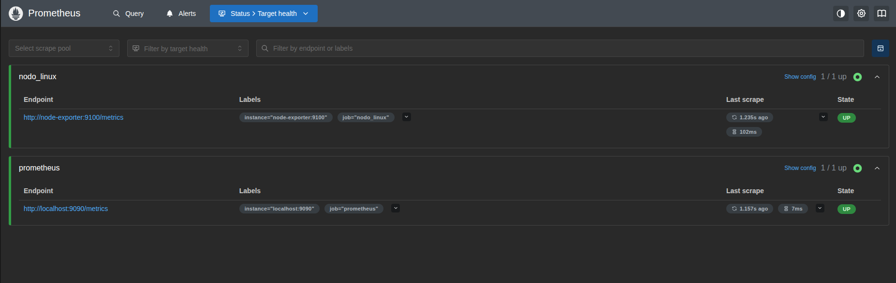
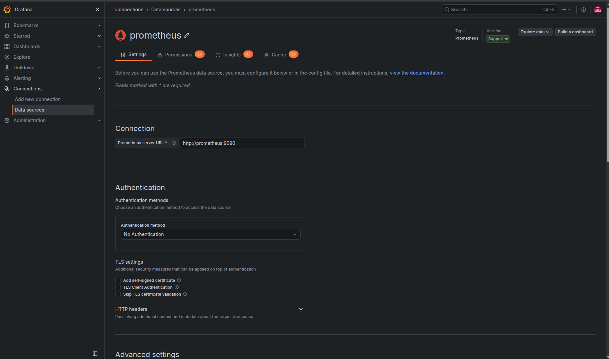

# Despliegue de un stack de monitorización (Prometheus + Grafana)
 
Entorno práctico en contenedores construido con **Docker Compose** para demostrar la recopilación de telemetría basada en *pull* (extracción) y su visualización en tiempo real (desarrollado para un seminario técnico en la ETSIIT – UGR).
 
El objetivo de esta configuración es demostrar de forma local el modelo de recopilación de métricas basado en *scraping* (**Pull**) y su visualización en tiempo real.
 
---
 
## Arquitectura del entorno
 
| Servicio | Imagen de Docker | Puerto local | Función |
| :--- | :--- | :---: | :--- |
| **Node Exporter** | `prom/node-exporter:latest` | `9100` | Expone métricas de hardware y del kernel de Linux en `/metrics`. |
| **Prometheus** | `prom/prometheus:latest` | `9090` | Recopila y almacena series temporales cada 5 segundos. |
| **Grafana** | `grafana/grafana:latest` | `3000` | Visualización interactiva mediante paneles (*dashboards*). |
 
---
 
## Requisitos previos
 
- Sistema operativo Linux (probado en **Ubuntu** / **Debian**).
- **Docker Engine** y el plugin **Docker Compose** (`docker compose version`).
### Instalación rápida de Docker (si no está instalado)
 
```bash
sudo apt update
sudo apt install -y ca-certificates curl
sudo install -m 0755 -d /etc/apt/keyrings
sudo curl -fsSL https://download.docker.com/linux/ubuntu/gpg -o /etc/apt/keyrings/docker.asc
sudo chmod a+r /etc/apt/keyrings/docker.asc
 
echo "deb [arch=$(dpkg --print-architecture) signed-by=/etc/apt/keyrings/docker.asc] https://download.docker.com/linux/ubuntu $(. /etc/os-release && echo "$VERSION_CODENAME") stable" | sudo tee /etc/apt/sources.list.d/docker.list > /dev/null
 
sudo apt update
sudo apt install -y docker-ce docker-ce-cli containerd.io docker-compose-plugin
sudo usermod -aG docker $USER
newgrp docker
```
 
---
 
## Archivos de configuración
 
### 1. `prometheus.yml`
Define el intervalo de recopilación (`scrape_interval`) y los objetivos monitorizados a través de la red interna de Docker:
 
```yaml
global:
  scrape_interval: 5s
 
scrape_configs:
  - job_name: 'prometheus'
    static_configs:
      - targets: ['localhost:9090']
 
  - job_name: 'linux_node'
    static_configs:
      - targets: ['node-exporter:9100']
```
 
### 2. `docker-compose.yml`
Orquesta los tres contenedores, montando los directorios del host (`/proc`, `/sys`, `/`) en modo solo lectura para que `node-exporter` pueda leer las métricas reales del sistema:
 
```yaml
services:
  node-exporter:
    image: prom/node-exporter:latest
    container_name: node-exporter
    restart: unless-stopped
    ports:
      - "9100:9100"
    volumes:
      - /proc:/host/proc:ro
      - /sys:/host/sys:ro
      - /:/rootfs:ro
    command:
      - '--path.procfs=/host/proc'
      - '--path.rootfs=/rootfs'
      - '--path.sysfs=/host/sys'
 
  prometheus:
    image: prom/prometheus:latest
    container_name: prometheus
    restart: unless-stopped
    volumes:
      - ./prometheus.yml:/etc/prometheus/prometheus.yml:ro
    ports:
      - "9090:9090"
 
  grafana:
    image: grafana/grafana:latest
    container_name: grafana
    restart: unless-stopped
    ports:
      - "3000:3000"
    environment:
      - GF_SECURITY_ADMIN_USER=admin
      - GF_SECURITY_ADMIN_PASSWORD=admin
```
 
---
 
## Arranque y verificación
 
1. **Inicia los contenedores en segundo plano:**
```bash
docker compose up -d
docker ps
```
 
2. **Comprueba la recopilación de métricas:**
   - **Métricas sin procesar:** `http://localhost:9100/metrics`
     
   - **Estado de los objetivos en Prometheus:** `http://localhost:9090/targets` (deberían aparecer como `UP`).
     
3. **Configura Grafana:**
   - Accede a `http://localhost:3000` (credenciales por defecto: `admin` / `admin`).
   - Añade una fuente de datos en **Connections → Data sources → Prometheus** apuntando a `http://prometheus:9090`.
     
   - Importa el panel oficial **Node Exporter Full** en **Dashboards → New → Import** usando el ID `1860`.
     
---
 
## Prueba de carga y apagado
 
Para generar un pico de CPU controlado en todos los núcleos disponibles y observar su impacto en las gráficas de Grafana:
 
```bash
for i in $(seq 1 $(nproc)); do yes > /dev/null & done
sleep 35
killall yes
```
 

 
Para generar un pico de CPU controlado en un solo núcleo, usa en su lugar:
 
```bash
yes > /dev/null &
sleep 15
killall yes
```
 
Para detener y eliminar los contenedores al terminar:
 
```bash
docker compose down
```
 
