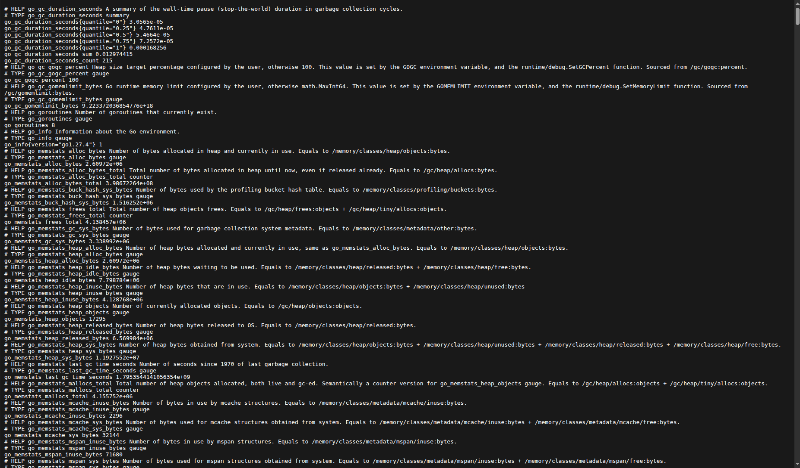
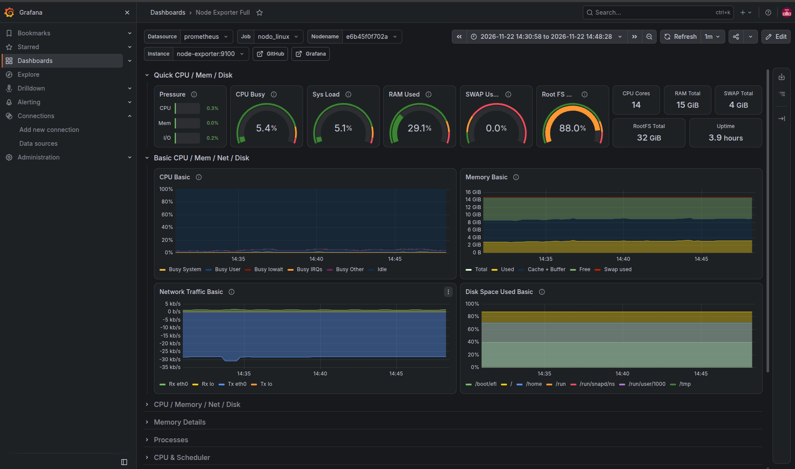
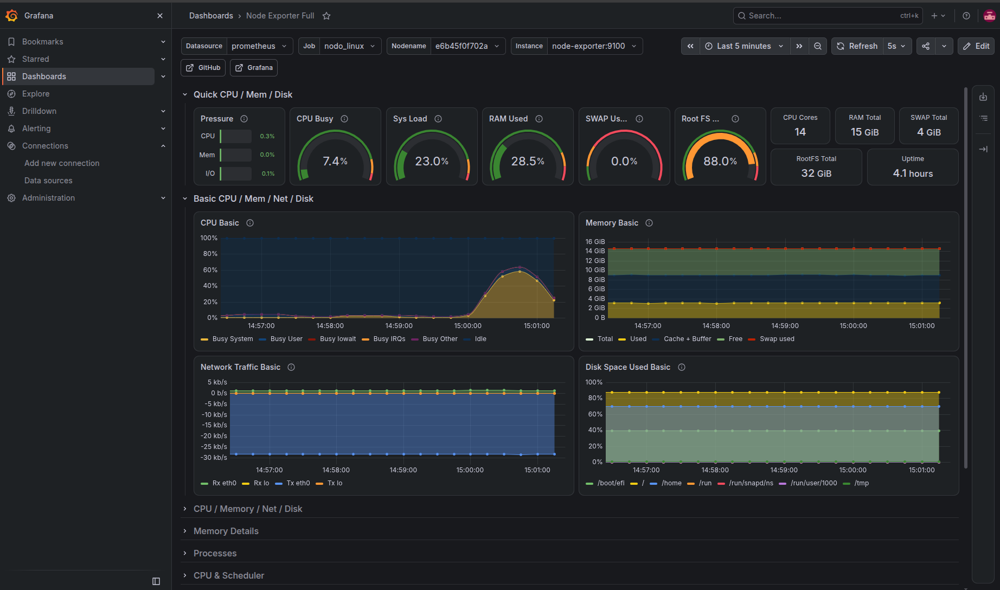
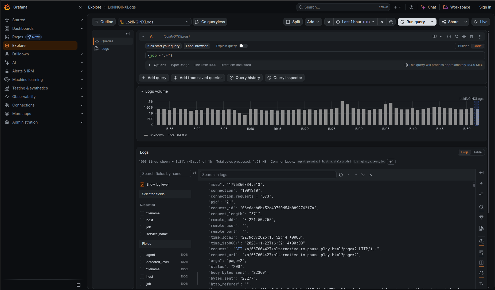
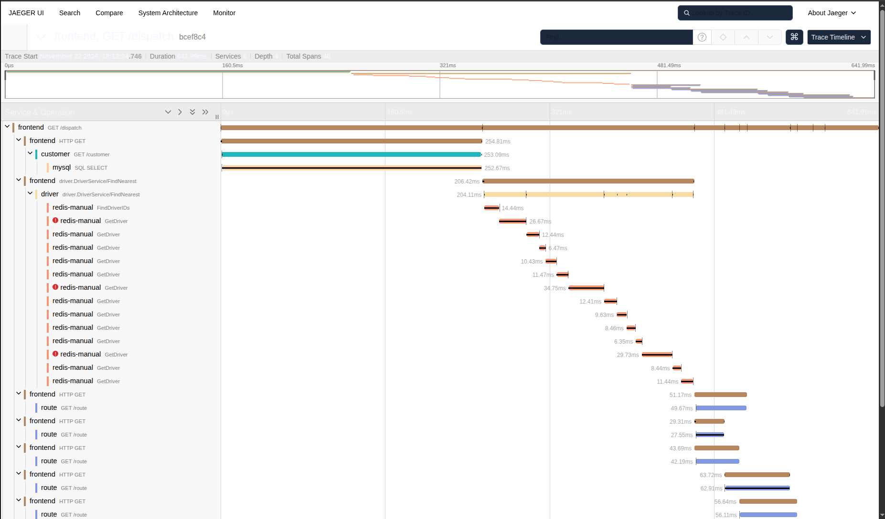

# Laboratorio de Monitorización, Observabilidad y Telemetría (Prometheus, Grafana, Loki y Jaeger)
 
Entorno práctico en contenedores construido con **Docker Compose** y **Docker** para demostrar los tres pilares de la observabilidad —**Métricas**, **Logs** y **Trazas Distribuidas**— junto con la visualización en tiempo real (desarrollado para un seminario técnico en la ETSIIT – UGR).
 
---
 
## Pilar 1: Métricas basadas en Pull (Prometheus + Grafana)
 
El objetivo de esta configuración es demostrar de forma local el modelo de recolección de métricas basado en *scraping* (**Pull**) y su visualización en tiempo real.
 
### Arquitectura del entorno
 
| Servicio | Imagen Docker | Puerto local | Función |
| :--- | :--- | :---: | :--- |
| **Node Exporter** | `prom/node-exporter:latest` | `9100` | Expone métricas de hardware y del kernel de Linux en `/metrics`. |
| **Prometheus** | `prom/prometheus:latest` | `9090` | Recolecta y almacena series temporales cada 5 segundos. |
| **Grafana** | `grafana/grafana:latest` | `3000` | Visualización interactiva mediante dashboards. |
 
### Requisitos previos
 
- Sistema operativo Linux (probado en **Ubuntu**).
- **Docker Engine** y el plugin **Docker Compose** (`docker compose version`).
#### Instalación rápida de Docker (si aún no está instalado)
 
```bash
sudo apt update
sudo apt install -y ca-certificates curl
sudo install -m 0755 -d /etc/apt/keyrings
sudo curl -fsSL https://download.docker.com/linux/ubuntu/gpg -o /etc/apt/keyrings/docker.asc
sudo chmod a+r /etc/apt/keyrings/docker.asc
 
echo "deb [arch=$(dpkg --print-architecture) signed-by=/etc/apt/keyrings/docker.asc] https://download.docker.com/linux/ubuntu $(. /etc/os-release && echo "$VERSION_CODENAME") stable" | sudo tee /etc/apt/sources.list.d/docker.list > /dev/null
 
sudo apt update
sudo apt install -y docker-ce docker-ce-cli containerd.io docker-compose-plugin
sudo usermod -aG docker $USER
newgrp docker
```
 
### Archivos de configuración
 
#### 1. `prometheus.yml`
Define el intervalo de recolección (`scrape_interval`) y los objetivos monitorizados a través de la red interna de Docker:
 
```yaml
global:
  scrape_interval: 5s
 
scrape_configs:
  - job_name: 'prometheus'
    static_configs:
      - targets: ['localhost:9090']
 
  - job_name: 'linux_node'
    static_configs:
      - targets: ['node-exporter:9100']
```
 
#### 2. `docker-compose.yml`
Orquesta los tres contenedores, montando los directorios del host (`/proc`, `/sys`, `/`) en modo solo lectura para que `node-exporter` pueda leer las métricas reales del sistema:
 
```yaml
services:
  node-exporter:
    image: prom/node-exporter:latest
    container_name: node-exporter
    restart: unless-stopped
    ports:
      - "9100:9100"
    volumes:
      - /proc:/host/proc:ro
      - /sys:/host/sys:ro
      - /:/rootfs:ro
    command:
      - '--path.procfs=/host/proc'
      - '--path.rootfs=/rootfs'
      - '--path.sysfs=/host/sys'
 
  prometheus:
    image: prom/prometheus:latest
    container_name: prometheus
    restart: unless-stopped
    volumes:
      - ./prometheus.yml:/etc/prometheus/prometheus.yml:ro
    ports:
      - "9090:9090"
 
  grafana:
    image: grafana/grafana:latest
    container_name: grafana
    restart: unless-stopped
    ports:
      - "3000:3000"
    environment:
      - GF_SECURITY_ADMIN_USER=admin
      - GF_SECURITY_ADMIN_PASSWORD=admin
```
 
### Puesta en marcha y verificación
 
1. **Inicia los contenedores en segundo plano:**
```bash
docker compose up -d
docker ps
```
 
2. **Comprueba la recolección de métricas:**
   - **Métricas en bruto:** `http://localhost:9100/metrics`
     
   - **Estado de los objetivos en Prometheus:** `http://localhost:9090/targets` (deberían aparecer como `UP`).
     
3. **Configura Grafana:**
   - Accede a `http://localhost:3000` (credenciales por defecto: `admin` / `admin`).
   - Añade una fuente de datos en **Connections → Data sources → Prometheus** apuntando a `http://prometheus:9090`.
     
   - Importa el dashboard oficial **Node Exporter Full** en **Dashboards → New → Import** usando el ID `1860`.
     
### Prueba de carga y apagado
 
Para generar un pico de CPU controlado en todos los núcleos disponibles (14 núcleos lógicos en el equipo de pruebas) y observar su impacto en las gráficas de Grafana:
 
```bash
for i in $(seq 1 $(nproc)); do yes > /dev/null & done
sleep 35
killall yes
```
 

 
Para generar en su lugar un pico de CPU controlado en un único núcleo:
 
```bash
yes > /dev/null &
sleep 15
killall yes
```
 
Para detener y eliminar los contenedores del stack de monitorización cuando hayas terminado:
 
```bash
docker compose down
```
 
---
 
## Pilar 2: Análisis centralizado de logs (Grafana Loki)
 
Para inspeccionar eventos discretos del sistema y de las aplicaciones sin conectarse manualmente por SSH a cada nodo, **Grafana Loki** agrega los logs enviados por agentes ligeros (como **Promtail**). A diferencia de los motores de indexación de texto completo (p. ej., ElasticSearch), Loki indexa únicamente las etiquetas de metadatos, lo que mantiene bajo el consumo de almacenamiento y memoria.
 
Usando el entorno público de pruebas **Grafana Play** (conjunto de datos `LokiNGINXLogs` a través de **Explore**), la exploración de logs se estructura en tres capas:
 
1. **Filtrado por etiquetas (superior):** Las consultas LogQL (p. ej., `{job=~".+"}`) filtran los flujos usando etiquetas de metadatos indexadas (`agent=promtail`, `host=appfelstrudel`, `job=nginx_access_log`) para aislar servidores y servicios concretos.
2. **Histograma de volumen de logs (central):** Muestra la tasa de ingesta de logs a lo largo del tiempo (82,4K entradas/hora), resaltando picos de tráfico o ráfagas repentinas de errores.
3. **Inspección forense de peticiones (inferior):** Expande las entradas individuales de log en JSON para inspeccionar la IP del cliente (`remote_addr`), la URI solicitada (`request`), el contenedor backend (`upstream`) y el código de respuesta HTTP (`status: "200"`).

 
---
 
## Pilar 3: Laboratorio de trazado distribuido (Jaeger + HotROD)
 
Para complementar las métricas del host y los logs con el trazado de peticiones de extremo a extremo a través de microservicios, se desplegó un laboratorio de observabilidad temporal usando **Jaeger** y la aplicación de demostración **HotROD** (un benchmark de microservicios de transporte compartido compuesto por 6 servicios: `frontend`, `customer`, `mysql`, `driver`, `redis-manual` y `route`).
 
### 1. Comandos de despliegue
 
Ejecuta Jaeger (`all-in-one`) y la aplicación HotROD en dos terminales separadas usando la red del host, de modo que las trazas de OpenTelemetry se exporten directamente mediante OTLP (`http://localhost:4318`):
 
```bash
# Terminal 1: Iniciar el backend y la interfaz de Jaeger
docker run --rm --network host jaegertracing/all-in-one
```
 
```bash
# Terminal 2: Iniciar los microservicios de HotROD y apuntar el exportador OTLP a Jaeger
docker run --rm --network host \
  -e OTEL_EXPORTER_OTLP_ENDPOINT=http://localhost:4318 \
  jaegertracing/example-hotrod all
```
 
### 2. Generación y análisis de trazas
 
1. Abre la interfaz web de HotROD en `http://localhost:8080` y lanza una solicitud de viaje (`GET /dispatch`).
2. Abre la interfaz de Jaeger en `http://localhost:16686`, selecciona el servicio **`frontend`** e inspecciona la línea temporal en cascada (waterfall) resultante.

 
### 3. Cuellos de botella y fallos identificados en la traza
 
Al inspeccionar la petición `frontend: GET /dispatch` (**641,99 ms** de duración total a lo largo de **6 servicios** y **40 spans**) se revelan tres problemas de causa raíz que son invisibles para las métricas estándar del host:
 
- **Cuello de botella de latencia en la base de datos:** El servicio `customer` ejecuta una consulta `mysql SQL SELECT` que tarda **252,67 ms** (~39 % del tiempo total de la petición).
- **Errores ocultos en la caché:** Varios spans `redis-manual GetDriver` muestran marcadores de error (`!`), lo que indica búsquedas fallidas y reintentos dentro del servicio `driver`.
- **Llamadas secuenciales sin paralelizar:** Dentro de `driver` (**204,11 ms**), varias llamadas `GetDriver` se ejecutan de forma secuencial, en patrón de escalera, en lugar de ejecutarse de manera concurrente.
 
