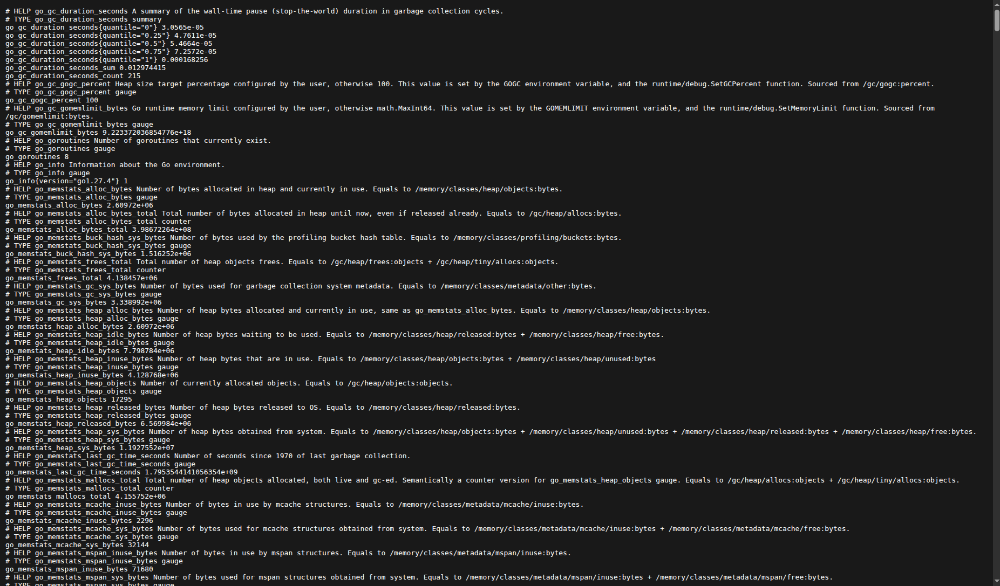
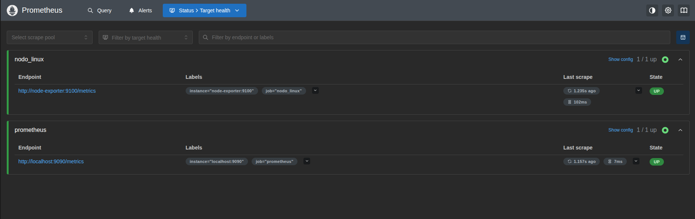
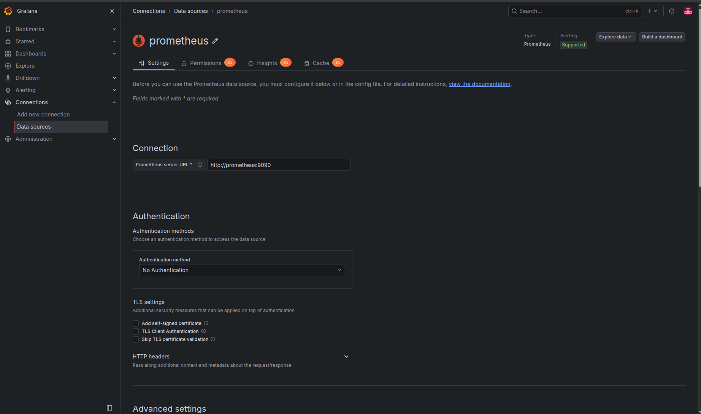
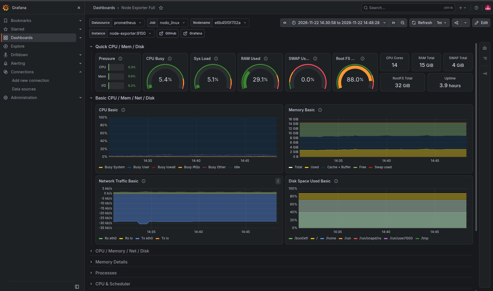
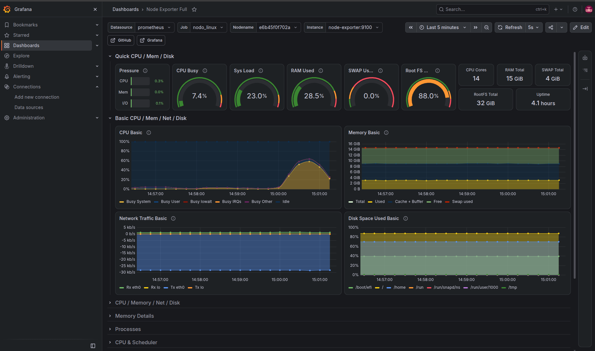
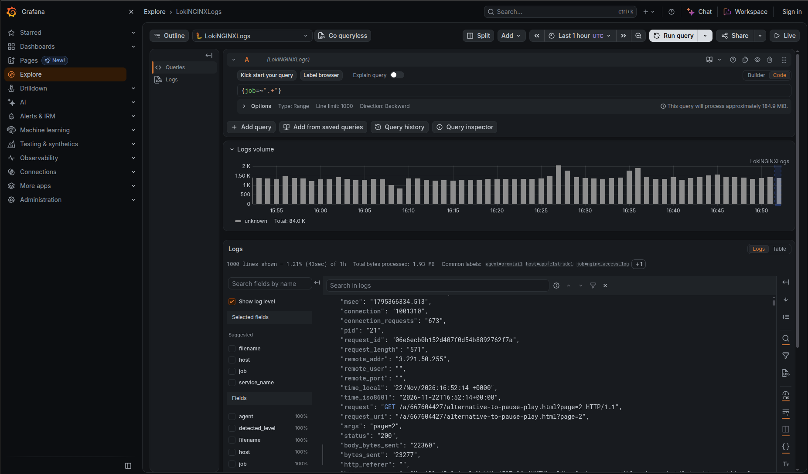
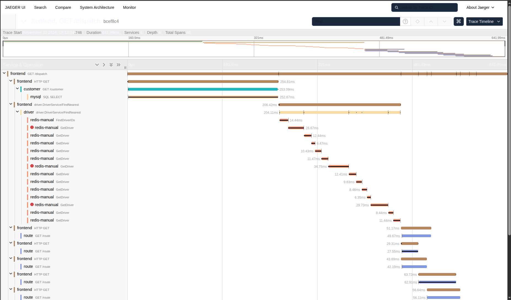

# Monitoring, Observability & Telemetry Stack Lab (Prometheus, Grafana, Loki & Jaeger)

Containerized hands-on environment built with **Docker Compose** and **Docker** to demonstrate the three pillars of observability—**Metrics**, **Logs**, and **Distributed Traces**—alongside real-time visualization (developed for a technical seminar at ETSIIT – UGR).

---

## Pillar 1: Pull-Based Metrics (Prometheus + Grafana)

The goal of this setup is to demonstrate locally the metric collection model based on *scraping* (**Pull**) and its real-time visualization.

### Environment Architecture

| Service | Docker Image | Local Port | Function |
| :--- | :--- | :---: | :--- |
| **Node Exporter** | `prom/node-exporter:latest` | `9100` | Exposes Linux hardware and kernel metrics at `/metrics`. |
| **Prometheus** | `prom/prometheus:latest` | `9090` | Collects and stores time series every 5 seconds. |
| **Grafana** | `grafana/grafana:latest` | `3000` | Interactive visualization through dashboards. |

### Prerequisites

- Linux operating system (tested on **Ubuntu**).
- **Docker Engine** and the **Docker Compose** plugin (`docker compose version`).

#### Quick Docker installation (if not already installed)

```bash
sudo apt update
sudo apt install -y ca-certificates curl
sudo install -m 0755 -d /etc/apt/keyrings
sudo curl -fsSL [https://download.docker.com/linux/ubuntu/gpg](https://download.docker.com/linux/ubuntu/gpg) -o /etc/apt/keyrings/docker.asc
sudo chmod a+r /etc/apt/keyrings/docker.asc

echo "deb [arch=$(dpkg --print-architecture) signed-by=/etc/apt/keyrings/docker.asc] [https://download.docker.com/linux/ubuntu](https://download.docker.com/linux/ubuntu) $(. /etc/os-release && echo "$VERSION_CODENAME") stable" | sudo tee /etc/apt/sources.list.d/docker.list > /dev/null

sudo apt update
sudo apt install -y docker-ce docker-ce-cli containerd.io docker-compose-plugin
sudo usermod -aG docker $USER
newgrp docker
```

### Configuration Files

#### 1. `prometheus.yml`
Defines the collection interval (`scrape_interval`) and the monitored targets through Docker's internal network:

```yaml
global:
  scrape_interval: 5s

scrape_configs:
  - job_name: 'prometheus'
    static_configs:
      - targets: ['localhost:9090']

  - job_name: 'linux_node'
    static_configs:
      - targets: ['node-exporter:9100']
```

#### 2. `docker-compose.yml`
Orchestrates the three containers, mounting the host directories (`/proc`, `/sys`, `/`) in read-only mode so that `node-exporter` can read the real system metrics:

```yaml
services:
  node-exporter:
    image: prom/node-exporter:latest
    container_name: node-exporter
    restart: unless-stopped
    ports:
      - "9100:9100"
    volumes:
      - /proc:/host/proc:ro
      - /sys:/host/sys:ro
      - /:/rootfs:ro
    command:
      - '--path.procfs=/host/proc'
      - '--path.rootfs=/rootfs'
      - '--path.sysfs=/host/sys'

  prometheus:
    image: prom/prometheus:latest
    container_name: prometheus
    restart: unless-stopped
    volumes:
      - ./prometheus.yml:/etc/prometheus/prometheus.yml:ro
    ports:
      - "9090:9090"

  grafana:
    image: grafana/grafana:latest
    container_name: grafana
    restart: unless-stopped
    ports:
      - "3000:3000"
    environment:
      - GF_SECURITY_ADMIN_USER=admin
      - GF_SECURITY_ADMIN_PASSWORD=admin
```

### Startup and Verification

1. **Start the containers in the background:**
   ```bash
   docker compose up -d
   docker ps
   ```

2. **Check metric collection:**
   - **Raw metrics:** `http://localhost:9100/metrics`

     

   - **Target status in Prometheus:** `http://localhost:9090/targets` (they should show as `UP`).

     

3. **Configure Grafana:**
   - Go to `http://localhost:3000` (default credentials: `admin` / `admin`).
   - Add a data source under **Connections → Data sources → Prometheus** pointing to `http://prometheus:9090`.

     

   - Import the official **Node Exporter Full** dashboard under **Dashboards → New → Import** using ID `1860`.

     

### Load Test and Shutdown

To generate a controlled CPU spike across all available cores (14 logical cores on the test host) and observe its impact on the Grafana charts:

```bash
for i in $(seq 1 $(nproc)); do yes > /dev/null & done
sleep 35
killall yes
```



To generate a controlled CPU spike on a single core instead:

```bash
yes > /dev/null &
sleep 15
killall yes
```

To stop and remove the monitoring stack containers when finished:

```bash
docker compose down
```

---

## Pillar 2: Centralized Log Analysis (Grafana Loki)

To inspect discrete system and application events without connecting manually via SSH to individual nodes, **Grafana Loki** aggregates logs pushed by lightweight agents (such as **Promtail**). Unlike full-text indexing engines (e.g., ElasticSearch), Loki indexes only metadata labels, keeping storage and memory overhead low.

Using the public **Grafana Play** sandbox (`LokiNGINXLogs` dataset via **Explore**), log exploration is structured into three layers:

1. **Label-Based Filtering (Top):** LogQL queries (e.g., `{job=~".+"}`) filter streams using indexed metadata labels (`agent=promtail`, `host=appfelstrudel`, `job=nginx_access_log`) to isolate specific servers and services.
2. **Log Volume Histogram (Middle):** Displays log ingestion rates over time (82.4K entries/hour), highlighting traffic surges or sudden bursts of errors.
3. **Forensic Request Inspection (Bottom):** Expands individual JSON log entries to inspect the client IP (`remote_addr`), requested URI (`request`), backend container (`upstream`), and HTTP response code (`status: "200"`).



---

## Pillar 3: Distributed Tracing Lab (Jaeger + HotROD)

To complement host metrics and logs with end-to-end request tracing across microservices, a temporary observability lab was deployed using **Jaeger** and the **HotROD** demo application (a ride-sharing microservice benchmark composed of 6 services: `frontend`, `customer`, `mysql`, `driver`, `redis-manual`, and `route`).

### 1. Deployment Commands

Run Jaeger (`all-in-one`) and the HotROD application in two separate terminals using host networking so OpenTelemetry traces are exported directly via OTLP (`http://localhost:4318`):

```bash
# Terminal 1: Start Jaeger backend and UI
docker run --rm --network host jaegertracing/all-in-one
```

```bash
# Terminal 2: Start HotROD microservices and point OTLP exporter to Jaeger
docker run --rm --network host \
  -e OTEL_EXPORTER_OTLP_ENDPOINT=http://localhost:4318 \
  jaegertracing/example-hotrod all
```

### 2. Trace Generation & Analysis

1. Open the HotROD web interface at `http://localhost:8080` and trigger a ride request (`GET /dispatch`).
2. Open the Jaeger UI at `http://localhost:16686`, select the **`frontend`** service, and inspect the resulting waterfall timeline.



### 3. Bottlenecks & Faults Identified in the Trace

Inspecting the single `frontend: GET /dispatch` request (**641.99 ms** total duration across **6 services** and **40 spans**) reveals three root-cause issues that are invisible to standard host metrics:

- **Database Latency Bottleneck:** The `customer` service executes a `mysql SQL SELECT` query that takes **252.67 ms** (~39% of the total request time).
- **Hidden Cache Errors:** Several `redis-manual GetDriver` spans display error markers (`!`), indicating failed lookups and retries inside the `driver` service.
- **Unparallelized Sequential Calls:** Within `driver` (**204.11 ms**), multiple `GetDriver` calls execute sequentially in a staircase pattern instead of running concurrently.
